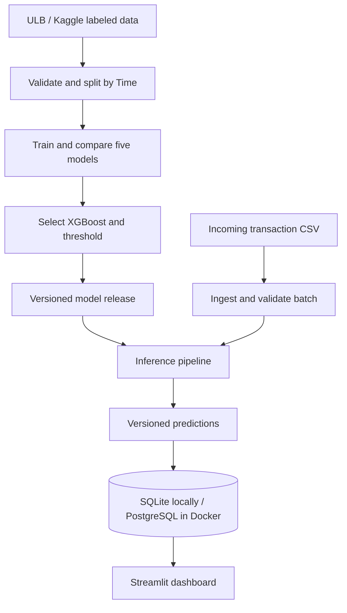

# FraudLens

**Credit-card fraud detection, from model evaluation to a working batch pipeline.**

FraudLens started with a fairly simple question: when fraud is rare, how do you catch more of it without burying legitimate transactions in false alarms?

I used the anonymized ULB credit-card dataset to compare a handful of classifiers, then built the rest of the application around the selected model: CSV validation, versioned predictions, a database, an Airflow pipeline, and a Streamlit dashboard. The same XGBoost release trained during the Kaggle experiment has also been tested inside the containerized pipeline.

This is a research and engineering project, **not a live card-payment service**. The dashboard runs locally, and the Docker integration is verified by GitHub Actions rather than hosted as a permanent public application.

## What you can do with it

- Validate incoming CSVs and keep rejected rows with reasons for rejection.
- Train and compare five classifiers, including class weighting and SMOTE-based training.
- Score batches that have no fraud label (`Class`) yet.
- Track transactions, model versions, predictions, and pipeline runs in SQLite or PostgreSQL.
- Review alerts, model evaluation, and run history through four Streamlit pages.
- Run training and inference as separate Airflow DAGs in Docker.
- Rerun an inference batch without inserting the same prediction decision twice.

## Real-data results

I used the [ULB credit-card fraud dataset on Kaggle](https://www.kaggle.com/datasets/mlg-ulb/creditcardfraud): 284,807 original transactions, of which 492 were labeled as fraud. After rejecting 1,081 exact duplicate rows, 283,726 records remained.

The split was chronological by the dataset's elapsed `Time` field, with matching timestamps kept in the same partition. I chose the model using **validation average precision** and chose its decision threshold using **validation F1**. Only then did I evaluate the selected model on the held-out test partition.

| Partition | Transactions | Fraud cases |
| --- | ---: | ---: |
| Training | 173,176 | 343 |
| Validation | 50,662 | 54 |
| Test | 59,888 | 76 |

### Model comparison

| Model | Validation average precision |
| --- | ---: |
| Dummy baseline | 0.0011 |
| Logistic Regression (class-weighted) | 0.7444 |
| Logistic Regression + SMOTE | 0.7557 |
| Random Forest | 0.7455 |
| **XGBoost** | **0.7677** |

XGBoost was selected with a decision threshold of **0.95**. On the held-out chronological test set:

| Metric | Result |
| --- | ---: |
| Precision | **88.52%** |
| Recall | **71.05%** |
| F1-score | **78.83%** |
| Average precision | **0.7954** |
| ROC-AUC | **0.9737** |
| True positives / false positives | **54 / 7** |
| False negatives / true negatives | **22 / 59,805** |

In practical terms, the model caught **54 of the 76 fraud cases** in the test set and missed 22. Seven legitimate transactions were flagged incorrectly. That trade-off matters more here than overall accuracy, since the dataset is overwhelmingly legitimate transactions.

The measurements and experiment details are in the [real-data model card](docs/real_model_card.md) and [recorded benchmark](docs/results/real-data-benchmark.json). The [Kaggle notebook](notebooks/02_real_data_benchmark.ipynb) and [experiment guide](docs/real_data_experiments.md) describe how the run was carried out.

## How the system fits together



**Training and inference are deliberately separate.** The deployed model is saved as an immutable release with metadata and a checksum. Inference loads that release, applies its saved preprocessing, and uses the threshold stored with the model rather than silently substituting a new one.

The database stores one prediction per transaction, model version, and threshold. This makes an identical rerun replay-safe. The dashboard's LOW / REVIEW / HIGH risk bands are display categories; they are not the same thing as the model's fraud decision threshold.

### Dashboard

| Page | What it shows |
| --- | --- |
| **Overview** | Scored transactions, flagged counts, risk distribution, and trends |
| **Transaction Explorer** | Searchable predictions, scores, and transaction details |
| **Model Performance** | Precision/recall, confusion matrix, comparisons, curves, and threshold analysis |
| **Pipeline Health** | Ingestion, validation, training, and inference run history |

## Run it locally

The quickest way to explore the dashboard uses the included **synthetic demonstration data**. You don't need AWS or Docker for this path.

Use Python 3.12:

```bash
python3.12 -m venv .venv
source .venv/bin/activate
python -m pip install -r requirements-dev.txt
python -m scripts.demo --dashboard
```

Open [http://localhost:8501](http://localhost:8501). The command creates a local SQLite demo database, trains candidates on the synthetic fixture, scores an unlabeled copy, and checks that a repeat run adds no new decisions. **The synthetic scores are not evidence of real-data fraud-detection accuracy.**

For subsequent runs with that synthetic demo, use:

```bash
python -m scripts.demo --skip-training --dashboard
```

### Open an existing real-model dashboard

The real-trained XGBoost release was also tested locally using an intentionally fraud-enriched set of **3,076 real-feature holdout rows**. That run stored 3,076 predictions in SQLite, flagged 54, and added no predictions on replay. This subset was prepared for the interface demonstration, **not** used as another independent accuracy test.

If you've retained that local database, you can open its dashboard without retraining:

```bash
test -f .local/fraudlens-real-demo.db
DATABASE_URL="sqlite:///$PWD/.local/fraudlens-real-demo.db" \
  python -m streamlit run dashboard/app.py
```

The SQLite file and source transaction data are intentionally not committed. The command above requires a database already created by the real-model demo; it does not download or recreate it.

## Docker, Airflow and the real model

The containerized stack has PostgreSQL, an Airflow scheduler/webserver, and Streamlit. It supports two different checks:

1. **Synthetic full-stack check:** train and score synthetic data, verify DAG execution, database persistence, replay safety, and dashboard connectivity.
2. **Real-model pipeline check:** download the [published Kaggle-trained XGBoost release](https://github.com/Szin7/Credit-card-fraud-detection-FraudLens-/releases/tag/kaggle-model), verify its SHA-256, import and register it in Docker/PostgreSQL, then score 6,080 **synthetic integration-test transactions** through Airflow. It does **not** retrain the Kaggle model.

Both have passed on GitHub-hosted runners:

- [Full-stack Docker/Airflow check — passed](https://github.com/Szin7/Credit-card-fraud-detection-FraudLens-/actions/runs/41317199864)
- [Real-model Docker/Airflow check — passed](https://github.com/Szin7/Credit-card-fraud-detection-FraudLens-/actions/runs/41322535119)
- [Tests and container builds — passed](https://github.com/Szin7/Credit-card-fraud-detection-FraudLens-/actions/runs/41326322968)

The real-model check confirmed that the imported XGBoost release scored **6,080 transactions**, repeated inference added **zero duplicate decisions**, and Streamlit could read the stored predictions and real-model metadata. The runners and their databases are temporary; a successful Action is **not** a persistent hosted deployment.

For setup and recovery instructions, see the [Docker runbook](docs/runbook.md) and [real-model container guide](docs/real_model_container.md). Don't use `docker compose down -v` as a routine cleanup step: it removes named-volume data.

## Tests

```bash
ruff check .
pytest -q
```

The final local integration changes passed **65 tests** with **2 skipped**; GitHub Actions also ran the tests with PostgreSQL and checked Docker image builds and Airflow DAG imports. The workflow runs above are the evidence for the container acceptance checks.

## Repository map

| Path | Purpose |
| --- | --- |
| `src/ingestion/`, `src/validation/` | Input snapshots, schema checks, rejected rows |
| `src/processing/`, `src/models/` | Model features, training, releases, inference |
| `src/database/`, `sql/` | Persistence, schema, and migrations |
| `dashboard/` | Streamlit app and four dashboard pages |
| `airflow/dags/` | Training and inference DAGs |
| `scripts/` | CLI pipelines, benchmark, import tools, acceptance checks |
| `notebooks/` | Data exploration and real-data benchmark |
| `tests/` | Unit and integration tests |
| `docs/` | Architecture, model cards, experiment notes, and runbooks |

## What this project does not claim

FraudLens is a **batch-processing research application**, not a real-time fraud authorization system. The original dataset covers a short historical period and does not include cardholder or merchant IDs for group-based evaluation. We haven't established long-term drift resilience, calibrated probabilities, production monitoring, or an operationally approved decision threshold.

The serialized model is shared separately as a GitHub Release asset; the raw Kaggle CSV and local SQLite databases are not in the repository. Only load the joblib model if you trust its source—checking a file hash confirms consistency, not safety.

For an actual deployment, I would next address dashboard authentication, secrets, alerting, audit requirements, data retention, and model monitoring. Those are outside the current portfolio scope.
