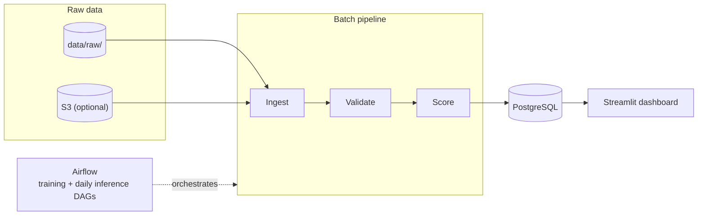

# FraudLens

A batch credit-card fraud detection platform: ingestion, validation,
feature engineering, model comparison, threshold analysis, PostgreSQL
persistence, Airflow orchestration, and a Streamlit monitoring dashboard.

## Why I Built This

Most fraud-detection projects online stop at "load CSV, call
`model.fit()`, print accuracy." That's a modeling exercise, not a fraud
pipeline — it skips the parts that actually take engineering judgment:
what happens when a row is malformed, how you avoid leaking test data into
training, whether SMOTE is allowed to see the validation set, why a 0.5
threshold is usually wrong, and where the numbers a dashboard shows
actually come from. I built FraudLens to work through those decisions end
to end, as both the ML engineering (imbalanced classification, leakage-safe
splitting, threshold tuning) and the data engineering (validation,
orchestration, a relational schema, a database-backed dashboard) that
surround the model.

## Architecture



Full diagrams (data lifecycle, both DAGs, training pipeline, inference
pipeline, AWS target architecture) are in
[docs/architecture.md](docs/architecture.md).

## What the System Does

1. Ingest a raw transaction CSV — check its structure, record a manifest.
2. Validate it — schema, value ranges, duplicates, missing values — and
   split into valid/rejected rows with a generated summary.
3. Build model features with a single fitted `ColumnTransformer`, reused
   identically at training and inference time.
4. Train and compare five model variants; select a champion by
   validation PR-AUC (not accuracy).
5. Sweep decision thresholds on the validation set to choose an operating
   point, and map probabilities to LOW/REVIEW/HIGH risk bands for the UI.
6. Persist transactions, predictions, and model metrics to PostgreSQL.
7. Orchestrate all of the above with Airflow — a manual training DAG and a
   daily inference DAG.
8. Serve a Streamlit dashboard reading exclusively from Postgres.

## Dataset

This repository ships **without** the real dataset. On first use it
generates a small, clearly-synthetic sample
(`data/raw/creditcard_sample.csv`) matching the real schema
(`Time, V1-V28, Amount, Class`) so the pipeline and dashboard work
out of the box. **Every metric in this README and in `docs/` was produced
by running the actual code against that synthetic sample** — see
[`data/raw/README.md`](data/raw/README.md) for exactly how it was
generated and how to substitute the real
[Kaggle Credit Card Fraud dataset](https://www.kaggle.com/datasets/mlg-ulb/creditcardfraud)
instead.

The real dataset (and the synthetic stand-in, by construction) is severely
imbalanced — fraud is a fraction of a percent of transactions — which is
why this project leads with PR-AUC/precision/recall instead of accuracy;
see the "Why accuracy is misleading" section of
[`notebooks/01_exploration.ipynb`](notebooks/01_exploration.ipynb) for a
concrete number: a classifier that never predicts fraud scores 99.50%
accuracy on this data while catching none of it.

`V1`-`V28` are PCA-anonymized with no disclosed real-world meaning in the
real dataset. This project never invents one for them — no "merchant,"
"device," or "location" columns exist here, in either the code or the
docs.

## Pipeline

```
Raw CSV → Ingestion → Validation → Feature build (in-pipeline) → Model →
Fraud probability → Risk classification → PostgreSQL → Dashboard
```

Every stage reads from and writes to a well-known disk location
(`data/raw/` → `data/processed/` / `data/rejected/` → Postgres), which is
what lets the same step run identically from a Makefile target or an
Airflow task — Airflow's `LocalExecutor` tasks don't share memory, so
handing off a 24k-row DataFrame in-process isn't an option once
orchestrated.

## Machine Learning Approach

- **Baseline:** a `DummyClassifier` that always predicts "legitimate" —
  the floor every other model has to beat, and the clearest illustration
  of why accuracy alone is meaningless here.
- **Models compared:** Logistic Regression, Random Forest, XGBoost, plus
  Logistic Regression with SMOTE oversampling as a fifth variant, all
  trained inside `Pipeline(features, model)`.
- **Imbalance handling, measured not assumed:** class weighting
  (`class_weight="balanced"` / `scale_pos_weight`) is the default for
  every model; SMOTE is compared head-to-head against it on Logistic
  Regression specifically, via `imbalanced-learn`'s `Pipeline` (SMOTE
  changes row counts, which scikit-learn's own `Pipeline` doesn't
  support), fit only on the training fold. On this dataset, SMOTE edged
  out class weighting (validation PR-AUC 0.9605 vs. 0.9565) — full table
  in [`docs/model_card.md`](docs/model_card.md).
- **Splitting:** stratified random (64/16/20 train/val/test,
  `random_state=42`), not chronological — investigated and documented in
  the model card; the dataset's 48-hour span with no seasonal structure
  makes a chronological cut riskier than stratification for a
  <1%-positive problem, though a longer-history dataset would change that
  answer.
- **Evaluation:** precision, recall, F1, ROC-AUC, and PR-AUC, with PR-AUC
  driving champion selection. Confusion matrix and both curves are in the
  dashboard's Model Performance page.
- **Threshold selection:** swept on the validation split (never test) by
  `scripts/optimize_threshold.py`; a human reviews the output and updates
  `config/settings.yaml`, rather than the script silently changing the
  production operating point.
- **Explainability:** native feature importance (coefficients /
  impurity-based) always available; SHAP attempted opportunistically and
  falling back to native importance on any error rather than raising
  (`src/models/explain.py`). Both describe *which inputs* moved a
  prediction, never invented real-world reasons.

## Data Engineering

- **Ingestion** (`src/ingestion/ingest.py`) — structural checks, a SHA-256
  checksum, a JSON manifest per run, and a pluggable storage backend
  (`STORAGE_MODE=local|s3`) via `src/storage/s3.py`.
- **Validation** (`src/validation/validator.py`) — per-row rule checks
  (missing values, invalid `Class`/`Amount`/`Time`, non-numeric features,
  duplicates), producing a valid/rejected split plus a generated summary —
  nothing here is hardcoded; run it yourself and the counts come from
  whatever file you point it at.
- **PostgreSQL** — `pipeline_runs`, `validation_results`, `transactions`,
  `model_runs`, `fraud_predictions`; see
  [`sql/schema.sql`](sql/schema.sql) and
  [`sql/useful_queries.sql`](sql/useful_queries.sql). Deliberately excludes
  `V1`-`V28` — the app layer never consumes them, so they stay in
  `data/processed/` as the model's feature-store input rather than
  duplicating 28 columns nobody reads.
- **Airflow** — `fraud_training_pipeline` (manual trigger) and
  `fraud_inference_pipeline` (`@daily`), two DAGs rather than one, since
  retraining shouldn't happen automatically every time inference runs. Runs
  only inside its own Docker image — Airflow's dependency tree regularly
  conflicts with app-level pandas/numpy/scikit-learn versions, so it never
  touches `requirements.txt` or the local venv.

## Dashboard

Four Streamlit pages on one design system (a restrained neutral palette,
one accent, three semantic risk colors — see
`dashboard/components/theme.py`), reading exclusively through
`src/database/repository.py`:

- **Overview** — KPIs, risk-over-time, risk distribution, recent
  high-risk transactions.
- **Transaction Explorer** — filterable/paginated search with a
  click-to-inspect detail panel.
- **Model Performance** — champion metrics, confusion matrix, PR/ROC
  curves, an interactive threshold-tradeoff chart, model comparison,
  feature importance.
- **Pipeline Health** — recent pipeline runs, status, throughput, last
  successful ingestion.

To see it: `make dashboard` (local) or `docker compose up` and open
<http://localhost:8501>, after running `make pipeline` at least once so
there's data to show.

## Project Structure

```
fraudlens/
├── config/settings.yaml       # tunable, non-secret config
├── data/{raw,processed,rejected}
├── src/
│   ├── ingestion/  validation/  processing/  features/
│   ├── models/     train.py, evaluate.py, predict.py, explain.py
│   ├── database/   models.py, connection.py, repository.py
│   ├── storage/    s3.py
│   └── utils/      config.py, logging.py
├── airflow/dags/   fraud_training_pipeline.py, fraud_inference_pipeline.py
├── dashboard/      app.py, pages/, components/
├── sql/            schema.sql, useful_queries.sql
├── scripts/        generate_sample_data.py, optimize_threshold.py, run_pipeline.py
├── tests/
├── notebooks/01_exploration.ipynb
└── docs/           architecture.md, data_dictionary.md, model_card.md,
                     interview_guide.md, resume_notes.md
```

## Running Locally

Requires Python 3.11+ (tested on 3.13) and, for the full stack, Docker.

```bash
python -m venv .venv
.venv/bin/activate       # .venv\Scripts\activate on native Windows
pip install -r requirements.txt
cp .env.example .env
```

Local (no Docker) — generates the synthetic sample, runs the full
pipeline against SQLite-free logic, and trains/scores locally:

```bash
make sample-data
make train
make threshold      # review output, optionally update config/settings.yaml
make predict
```

Full stack (Postgres + Airflow + dashboard):

```bash
docker compose up --build
```

- Dashboard: <http://localhost:8501>
- Airflow UI: <http://localhost:8080> (default login `admin` / `admin`,
  configurable via `AIRFLOW_ADMIN_USER` / `AIRFLOW_ADMIN_PASSWORD` in
  `.env` — local dev only, not a production credential)
- Trigger `fraud_training_pipeline` once, then `fraud_inference_pipeline`,
  from the Airflow UI to populate Postgres end to end.

## Running Tests

```bash
pytest
```

Runs entirely against SQLite (repository tests) and a moto-mocked S3
bucket (storage tests) — no Docker or real AWS credentials required.

## Configuration

Non-secret tunables live in `config/settings.yaml` (random seed, risk
bands, decision threshold, illustrative cost model, file paths). Secrets
and environment-specific values live in `.env` (copy from `.env.example`):
storage mode, database connection, S3 bucket, Airflow admin login. AWS
credentials are never read from either file — standard `boto3` credential
resolution (env vars, `~/.aws/credentials`, or an IAM role) applies.

## Results

All numbers below come from actually running `src/models/train.py` and
`scripts/optimize_threshold.py` against the bundled **synthetic** sample —
see [`docs/model_card.md`](docs/model_card.md) for the full comparison
table, confusion matrix, and caveats.

| | |
|---|---|
| Champion model | Logistic Regression + SMOTE |
| Validation PR-AUC | 0.9605 |
| Test PR-AUC | 0.9427 |
| Test ROC-AUC | 0.9993 |
| Test precision / recall (threshold 0.60) | 0.8077 / 0.8750 |
| Dummy-baseline PR-AUC (floor) | 0.0049 |

## Engineering Decisions

- **Feature engineering lives inside the persisted model pipeline, not as
  a separate script or Airflow task.** A single fitted `ColumnTransformer`
  runs identically at train and predict time; splitting it out would mean
  two copies of the same logic that can drift apart.
- **The dashboard only ever talks to Postgres.** Feature importance,
  threshold sweeps, and curve data are computed once during training and
  persisted into `model_runs.curve_data`, specifically so the dashboard's
  Docker image and container stay decoupled from the training
  environment's filesystem and ML dependencies.
- **Airflow never enters the main venv or `requirements.txt`.** It only
  runs inside its own Docker image with its own thin requirements file —
  the alternative (one shared venv) is a well-known source of dependency
  conflicts between Airflow's pins and an app's own ML stack.
- **SMOTE is measured against class weighting, not assumed better.** See
  Machine Learning Approach above.
- **Stratified split over chronological**, investigated and documented
  rather than defaulted to — see Machine Learning Approach above and the
  model card.
- **Postgres excludes `V1`-`V28`.** See Data Engineering above.

## Limitations

- All performance numbers describe the bundled synthetic sample, not the
  real dataset — re-run everything against the real Kaggle CSV before
  trusting any number here for a real decision.
- The synthetic sample's fraud-row feature shift is closer to linearly
  separable than real fraud likely is, which is almost certainly why
  Logistic Regression edged out the tree ensembles here — don't read that
  as a general "linear beats boosting for fraud" claim.
- Validation/test splits contain 19 and 24 fraud examples respectively at
  this sample size — several metrics move in large discrete steps and are
  noisy; the real 284,807-row dataset would give more stable estimates.
- `transaction_id` is a UUID minted at validation time (the raw schema has
  no natural identifier), so re-running the pipeline against the same
  static sample file inserts what looks like a fresh batch each time
  rather than being idempotent against a real upstream ID.
- No drift detection, scheduled retraining trigger, or streaming ingestion
  exists yet — see Future Improvements.
- No authentication on the dashboard or Airflow beyond Airflow's own
  default login; not intended for anything beyond local/demo use.

## Future Improvements

- **Kafka / simulated streaming** — the codebase is structured so this
  could be added as a V2 ingestion path without touching validation,
  features, or the model; not implemented here.
- **Model drift detection** — comparing live prediction-probability
  distributions against the training distribution over time.
- **Scheduled retraining** — promoting `fraud_training_pipeline` from
  manual-trigger to a review-gated schedule once there's a real drift
  signal to trigger on.
- **Feature store** — if features were ever shared across more than one
  model or one pipeline, formalizing `data/processed/` into an actual
  feature store would start paying for itself.
- **CI/CD** — running `pytest` and a lint check on every push; not set up
  in this repository.

---

See [docs/interview_guide.md](docs/interview_guide.md) for a walkthrough
of the reasoning behind every major decision, and
[docs/resume_notes.md](docs/resume_notes.md) for how this project is
summarized elsewhere.
