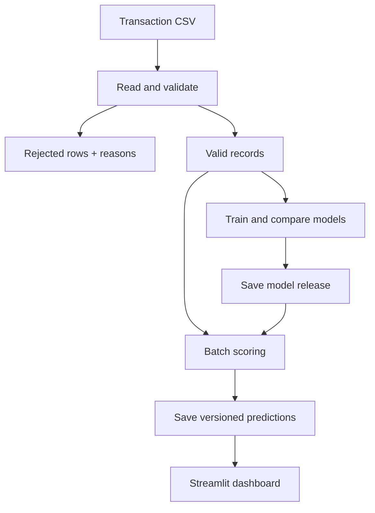

# FraudLens

**Credit-card fraud detection and transaction risk analysis**

FraudLens began as a way to explore a question that comes up quickly when learning machine learning: how do you find a rare event without producing too many false alarms? Credit-card fraud is a useful case because fraudulent transactions make up a very small share of the data.

The project brings together data validation, a comparison of classification models, batch scoring, and a dashboard for reviewing results. I also built out the supporting pipeline so repeated runs are easier to inspect and do not create duplicate prediction decisions.

> **Project status:** Five classifiers have been evaluated on the real ULB/Kaggle credit-card dataset. The selected XGBoost model has been tested locally with SQLite and Streamlit; Docker/Airflow integration passed on a GitHub-hosted runner using synthetic test data. This is a research and portfolio project, not a live payment-fraud service.

## What it does

- Reads transaction CSV files and separates invalid records, keeping an explanation of why each row was rejected.
- Trains and compares a dummy baseline, weighted Logistic Regression, Logistic Regression with SMOTE, Random Forest, and XGBoost.
- Chooses a model using validation average precision, then selects its classification threshold using validation F1.
- Scores new batches without requiring a known `Class` label.
- Stores transactions and versioned predictions in SQLite (local demo) or PostgreSQL.
- Provides four Streamlit pages: Overview, Transaction Explorer, Model Performance, and Pipeline Health.
- Includes scheduled batch inference with Airflow, Docker setup, and automated tests.

## How the pieces fit together



Training and scoring are separate workflows. A fitted preprocessing pipeline is saved with each model so the same transformations run during inference. SMOTE is used only on training data. The database also prevents a rerun from inserting the same decision twice for a given transaction, model version, and threshold.

## Run the local demo

The easiest way to explore the application is with Python 3.12. No Docker or AWS account is required.

```bash
python3.12 -m venv .venv
source .venv/bin/activate
python -m pip install -r requirements-dev.txt
python -m scripts.demo --dashboard
```

For Windows PowerShell, activate with `.venv\\Scripts\\Activate.ps1`. If needed, use `py -3.12` to create the environment.

Open **http://localhost:8501**. The demo creates synthetic labeled data, trains the model candidates, scores an unlabeled copy, and verifies that scoring the same batch again adds no duplicate predictions. Its dashboard counts are **not** an independent estimate of model accuracy.

After the initial run:

```bash
python -m scripts.demo --skip-training --dashboard
```

## The data and experiments

The checked-in sample was generated for demonstration. It is **not** the real credit-card dataset, and the high synthetic benchmark scores should not be read as real-world performance.

The reference dataset used for planned experiments is [Credit Card Fraud Detection on Kaggle](https://www.kaggle.com/datasets/mlg-ulb/creditcardfraud). It uses `Time`, `Amount`, `V1`-`V28`, and the binary target `Class`. The `V` columns are anonymous components; their real-world meanings are not available.

For a real-data experiment, use the [experiment guide](docs/real_data_experiments.md) and `scripts/benchmark_real_data.py`. A checked model export can be imported with `scripts/import_model_release.py`. The runner uses the existing validation, training, and model-selection code without requiring PostgreSQL or Airflow. A chronological split is the default; the test set is reserved until after model and threshold selection.

The [synthetic model card](docs/model_card.md) and [synthetic benchmark](docs/results/synthetic-benchmark.json) remain separate from the [real-data model card](docs/real_model_card.md) and [measured results](docs/results/real-data-benchmark.json).

## Full pipeline with Docker

For the PostgreSQL and Airflow version, see [the runbook](docs/runbook.md). The configuration uses local ports `8080` for Airflow and `8501` for Streamlit. Training is triggered manually; batch inference has a daily DAG.

```bash
cp .env.example .env
# Review credentials and set DATASET_KIND=synthetic for the bundled demonstration.
docker compose up --build -d
```

A GitHub-hosted full-stack test completed successfully, covering PostgreSQL, Airflow training and inference, replay safety, and dashboard database connectivity. The test uses synthetic inputs; the real-data model was evaluated separately.

For the optional Kaggle-trained model deployment, see [running the real model in Docker](docs/real_model_container.md).

## Verification

The GitHub Actions run on October 13, 2026 passed **56 tests** with **85% recorded line coverage**, PostgreSQL integration checks, linting, Docker image builds, and DAG import checks. Details and remaining tests are in [verification.md](docs/verification.md).

```bash
pytest -q
ruff check .
```

## Project files

| Location | Purpose |
|---|---|
| `src/ingestion`, `src/validation` | File snapshots and input checks |
| `src/features`, `src/models` | Feature processing, model training, scoring, and releases |
| `src/database`, `sql` | Database access, schema, and migrations |
| `dashboard` | Streamlit pages and chart components |
| `scripts` | Local demo, benchmark, and pipeline commands |
| `airflow/dags` | Training and inference workflows |
| `tests` | Regression and integration checks |
| `docs` | Data definitions, model results, architecture, and operations |

## Limits and further work

This is a batch project, not a real-time card authorization system. The demo uses fabricated features and has no proof of real-world detection accuracy. The application does not yet provide authenticated dashboard access, automated drift alerts, calibrated risk probabilities, or a distributed model registry. Fallback IDs derived from identical feature rows can combine distinct transactions; real systems should supply stable transaction IDs.

The real-data benchmark and local model verification are documented. The Docker/Airflow integration passed on a GitHub-hosted runner; the [verification checklist](docs/completion_checklist.md) records what has and has not passed.
