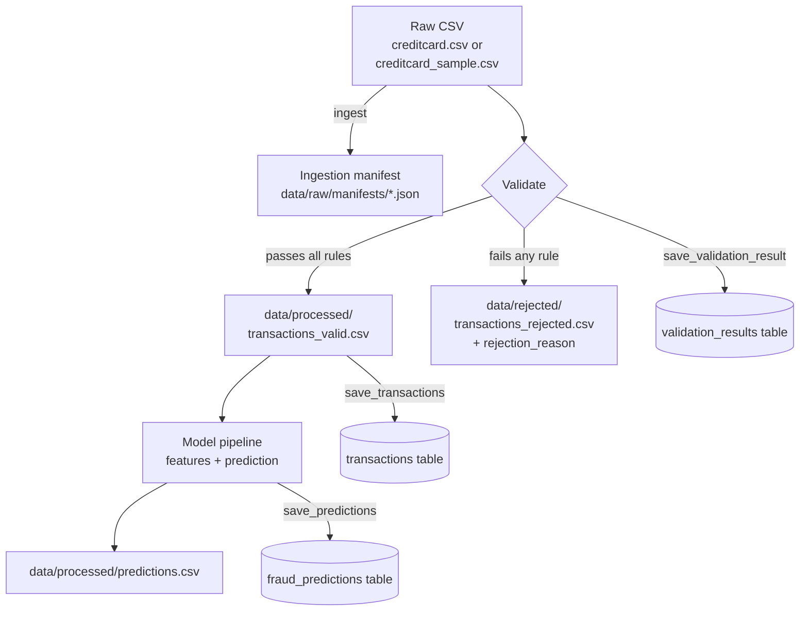
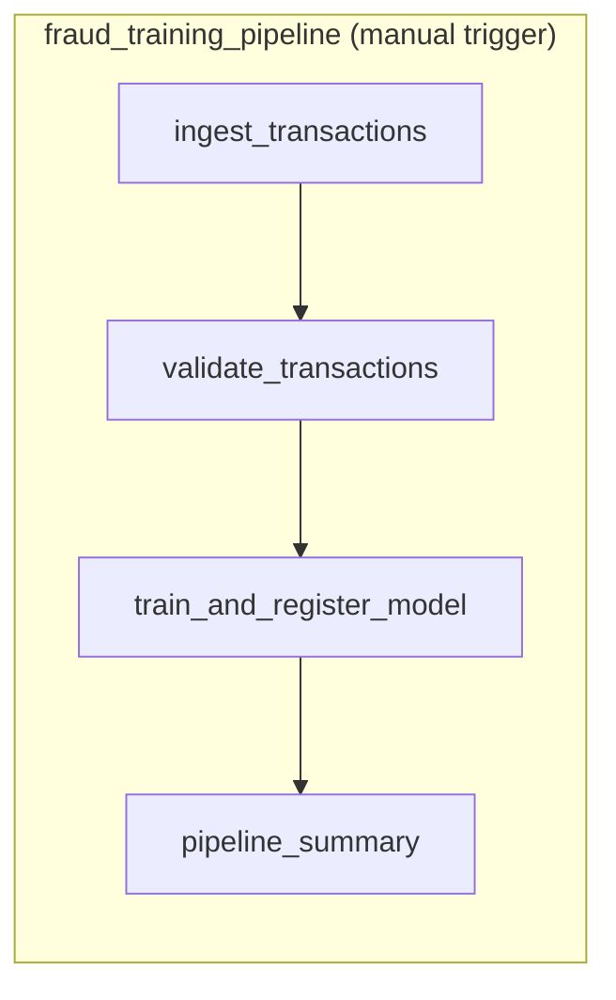
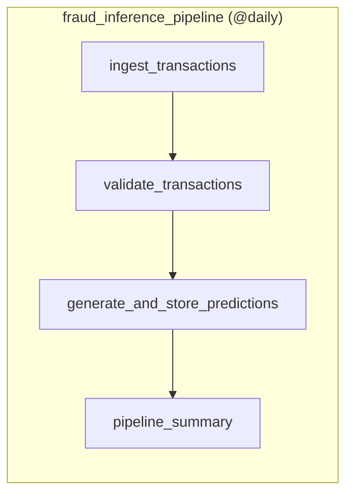
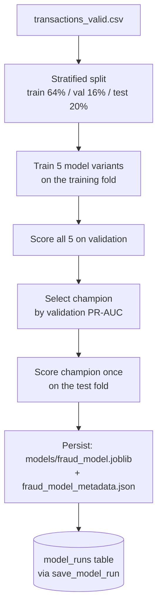
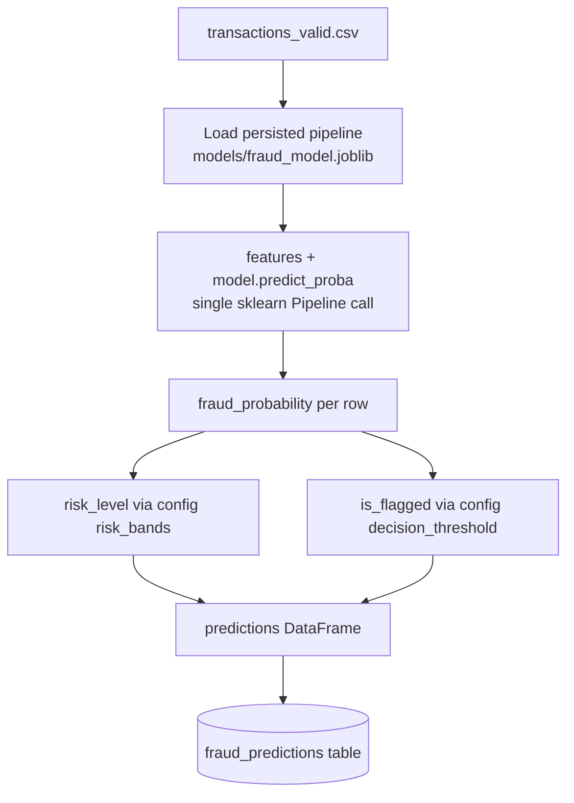
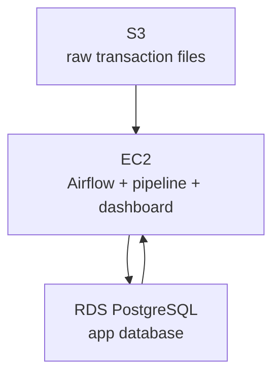

# Architecture

## Overall architecture

```mermaid
flowchart LR
    subgraph Storage["Raw data"]
        Local[("data/raw/\n(local disk)")]
        S3[("S3 bucket\n(STORAGE_MODE=s3)")]
    end

    subgraph Pipeline["Batch pipeline (src/, scripts/)"]
        Ingest[Ingestion]
        Validate[Validation]
        Predict[Feature build + scoring\n(inside the model pipeline)]
    end

    subgraph Orchestration["Airflow (Docker only)"]
        TrainDAG[fraud_training_pipeline\nmanual trigger]
        InferDAG[fraud_inference_pipeline\n@daily]
    end

    DB[(PostgreSQL\napp database)]
    Dashboard[Streamlit dashboard]

    Local --> Ingest
    S3 --> Ingest
    Ingest --> Validate
    Validate --> Predict
    Predict --> DB
    DB --> Dashboard

    TrainDAG -.orchestrates.-> Ingest
    TrainDAG -.orchestrates.-> Validate
    InferDAG -.orchestrates.-> Ingest
    InferDAG -.orchestrates.-> Validate
    InferDAG -.orchestrates.-> Predict
```

Every pipeline stage is a pure function of well-known disk locations: read
from a known input path, write to a known output path, return a small
summary. That's what makes the same step callable identically from a
Makefile target, a plain CLI invocation, or an Airflow task — and it's
required for Airflow specifically, since LocalExecutor tasks don't share
memory and can't pass a 24k-row DataFrame through XCom.

## Why each piece of infrastructure is here

| Component | Problem it solves |
|---|---|
| **PostgreSQL** | The dashboard needs to query "recent high-risk transactions" and "model comparison over time" with filters, joins, and aggregates — a relational store fits that access pattern far better than re-reading CSVs on every page load. |
| **S3 (optional)** | Local disk works for a laptop; a real deployment needs raw data to survive past the lifetime of one EC2 instance. `STORAGE_MODE=s3` swaps the storage backend without touching pipeline logic. |
| **Airflow** | Five sequential batch steps, run on a schedule, need retries and one visible failure point instead of five separate cron jobs with no shared state. |
| **Docker Compose** | Postgres + Airflow (3 processes) + the dashboard is more than "run one script" — Compose makes `docker compose up` reproduce the whole stack identically on any machine. |
| **sklearn Pipeline/ColumnTransformer** | The same fitted preprocessing (log-transform, scaling, cyclical time encoding) has to run identically at training and prediction time, or the model silently sees differently-shaped input in production than it was trained on. |

## Data lifecycle



A raw-schema transaction has no natural identifier, so `transaction_id` is
minted as a UUID4 at the validation boundary — the point a row first
becomes a tracked record — and flows unchanged through features,
prediction, and Postgres. A production system would instead receive this
ID from the upstream payment processor; see Limitations in the model card.

## Airflow DAGs

Two DAGs, not one — see `airflow/dags/`. Training is deliberately **not**
part of the scheduled daily run:





Two deliberate departures from a naive one-task-per-verb DAG:

- **No separate `build_features` task.** Feature transformation is fit
  once during training and persisted as part of the model pipeline
  (`src/features/build_features.py`, wrapped in the joblib artifact).
  Re-implementing that transform as a standalone Airflow task would mean
  running two copies of the same logic — exactly the training/serving skew
  a shared `ColumnTransformer` exists to prevent.
- **`generate_predictions` and `store_predictions` are one task.**
  Predictions are a full DataFrame; passing bulk data between Airflow
  tasks via XCom (which persists through the metadata database) is a
  documented anti-pattern. Scoring and writing straight to Postgres inside
  one task is the correct approach, not a shortcut.

Both DAGs share `retries=2` / `retry_delay=2min` via `default_args`, and
every task raises on failure with the underlying exception logged — Airflow
marks the task (and downstream tasks) failed rather than silently
continuing on bad data.

## ML training pipeline



The five variants: a `DummyClassifier` baseline, Logistic Regression with
`class_weight="balanced"`, the same Logistic Regression with SMOTE
oversampling instead (via `imblearn.Pipeline`, fit only on the training
fold), Random Forest, and XGBoost. See `docs/model_card.md` for the actual
measured metrics and why PR-AUC (not accuracy) drives model selection.

## ML inference pipeline



`risk_level` and `is_flagged` are computed from the same probability but
are not the same concept: `risk_level` (LOW/REVIEW/HIGH) is a UI triage
category for a human reviewer, configurable independently of the model;
`is_flagged` is the actual operating decision at the threshold chosen by
`scripts/optimize_threshold.py`. A transaction can be shown as HIGH risk
without crossing the decision threshold, and the two are deliberately
allowed to disagree near the boundary.

## Database design notes

- `transactions` stores `Time`/`Amount`/`Class` per row but **not**
  `V1`-`V28`. Nothing in the app/dashboard layer consumes the anonymized
  PCA features directly — they're the model's input, not the product's —
  so they stay in `data/processed/` as the feature store input rather than
  being duplicated into 28 extra Postgres columns nobody reads.
- `model_runs.curve_data` is a JSONB blob holding the PR curve, ROC curve,
  threshold sweep, confusion matrix, and feature importance for that
  model. This is a deliberate use of JSONB for document-shaped data (arrays
  of points) rather than normalizing curves into their own table — the
  dashboard always reads a curve as a whole, never filters by individual
  point, so there's no relational access pattern to justify more tables.
- The dashboard (`dashboard/`) only ever queries Postgres through
  `src/database/repository.py`. It never imports the model, opens
  `data/processed/`, or reads `models/` — that boundary is what lets the
  dashboard's Docker image stay small and lets it run as a read-only
  reporting layer independent of whatever machine last ran training.
- `is_champion` uniqueness (at most one `true` row in `model_runs`) is
  enforced two ways: a partial unique index in `sql/schema.sql` on the real
  Postgres database, and `repository.save_model_run()` explicitly unsetting
  the previous champion inside the same transaction.

## AWS deployment (design only — not deployed)



- **Why S3** — durable, versioned storage for raw transaction files that
  outlives any single compute instance; `src/storage/s3.py` already
  implements this behind `STORAGE_MODE=s3`, tested against a mocked S3
  (`moto`) rather than real AWS.
- **Why EC2** — the pipeline, Airflow, and dashboard are already packaged
  as Docker Compose services; an EC2 instance running that same Compose
  file is the smallest change from "runs on my laptop" to "runs in AWS."
- **Why RDS** — managed backups, patching, and failover for the same
  Postgres schema already defined in `sql/schema.sql`, without hand-rolling
  those operational concerns.

Deliberately excluded: ECS/EKS (Compose-on-EC2 is simpler at this scale
and the workload is a handful of long-running containers, not a
fleet needing orchestration), Lambda (the pipeline runs for minutes, not
milliseconds, and needs persistent Airflow state), and a managed Airflow
service (MWAA) — self-hosting on the same EC2 instance avoids paying for
and configuring a separate managed control plane for two DAGs.
